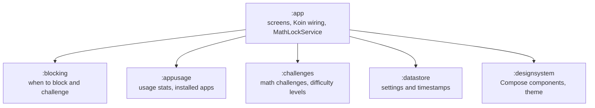
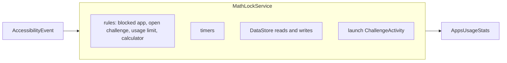
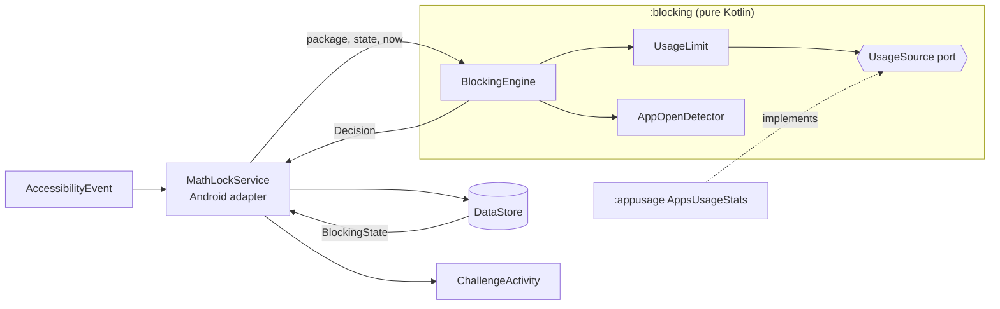
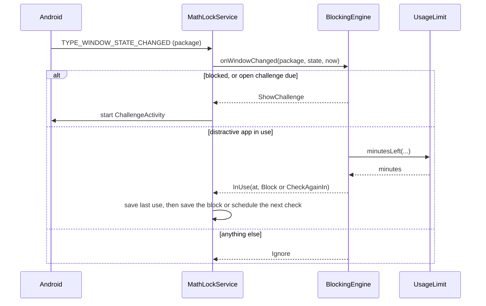

# Architecture

PlugBrain watches which app is in front and, when the user has spent their block interval in
distracting apps, covers them with a math challenge. This page explains how the code is split and
where to add things.

## Modules

Only `:app` depends on other modules; every library module stands alone.

| Module | Kind | Tested by |
|---|---|---|
| `:blocking` | Kotlin JVM, no Android, no coroutines, no clock | JVM unit tests |
| `:challenges` | Kotlin JVM | JVM unit tests |
| `:datastore` | Kotlin JVM (DataStore Preferences core) | JVM unit tests |
| `:appusage` | Android library (`UsageStatsManager`, `PackageManager`) | JVM unit tests |
| `:designsystem` | Android library (Compose) | Paparazzi snapshots |
| `:app` | Android app | JVM tests, Paparazzi, emulator tests |

## Blocking: rules in `:blocking`, Android in `MathLockService`

The blocking rules used to live inside the accessibility service, mixed with Android calls,
DataStore writes and timers. They could only be tested on an emulator.

Before:

Now the rules are a plain Kotlin class, and the service is a thin adapter around it (ports and
adapters):

- `BlockingState` is what the rules read: distractive apps, block interval, the "Also on app open"
  switch, whether the apps are blocked, and the last block and solve times. The service copies it
  from DataStore, so `:blocking` doesn't depend on `:datastore`.
- Time is an argument (`now: Long`), never read inside `:blocking`. Tests pass plain numbers.
- `UsageSource` is the only way the rules see usage. The app binds it over `AppsUsageStats` in Koin.
  Emulator tests replace `AppsUsageStats` with a fake, so blocking happens in seconds.
- `BlockingEngine` keeps the only state the rules need between events: which app is in front, and
  when the last open challenge was shown.

### One window event

The service keeps only what needs Android: the DataStore collector, the wall-clock loop for the next
usage check, launching the challenge and checking again 700 ms later if an app came back over it,
the calculator toast, and looking up the keyboard package.

### Difficulty

Each solved challenge raises the difficulty by one level (up to the hardest), in
`ArithChallengeViewModel.unblockApps`. `DifficultyDecay` in `:blocking` lowers it by one level per
two block intervals without a challenge. The floor, the minimal difficulty the user chose, is
applied inside the DataStore edit so the read and write are atomic.

## Adding a rule

1. Add what the rule needs to `BlockingState` (and map it in `MathLockService.blockingState()`).
2. Add the rule to `BlockingEngine`, returning an existing `Decision` if one fits.
3. Write a JVM test in `BlockingEngineTest` first; it runs in milliseconds.
4. Touch `MathLockService` only if the rule needs a new Android capability (for example
   `getWindows()` for split screen).

## Why `MathLockService` keeps its name

Android remembers an enabled accessibility service by its class name. Renaming the class would turn
the service off for every user who updates, and they would have to find and enable it again. The
app was called MathLock before PlugBrain.

## Checks on every pull request

ktlint, detekt and Android Lint with zero findings allowed; JVM unit tests with a merged Kover
coverage floor; Paparazzi snapshot tests; emulator UI tests; an APK size limit; and a PR size
limit of 300 changed lines, not counting tests.
