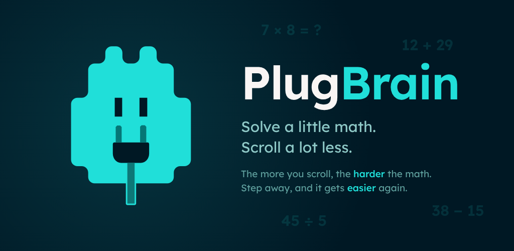
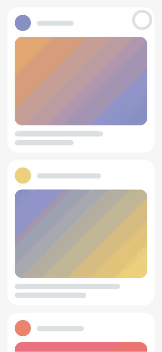
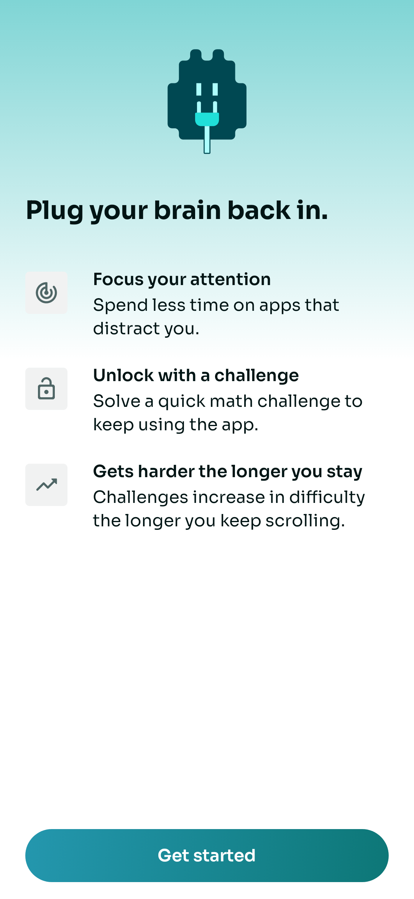
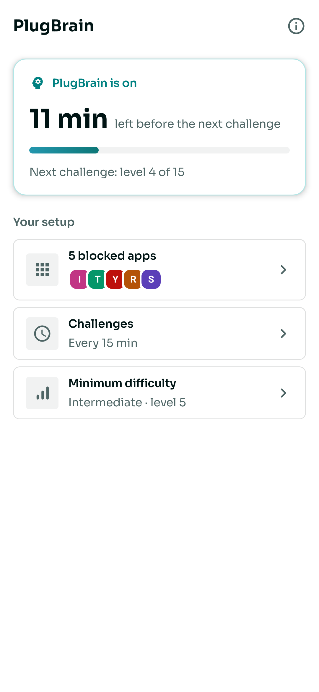
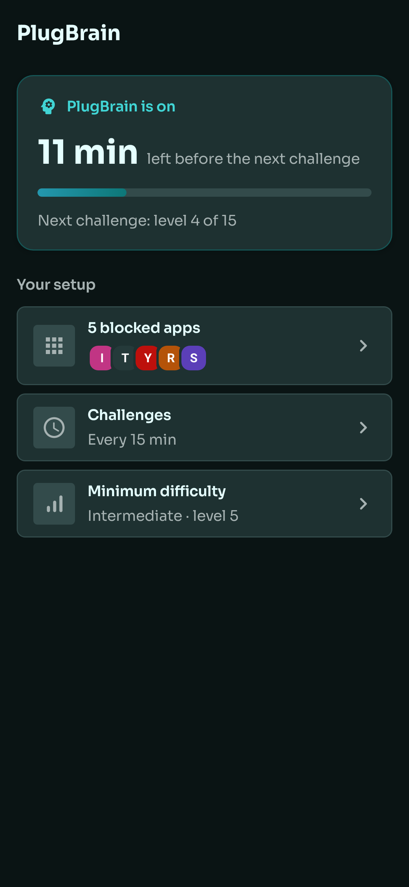
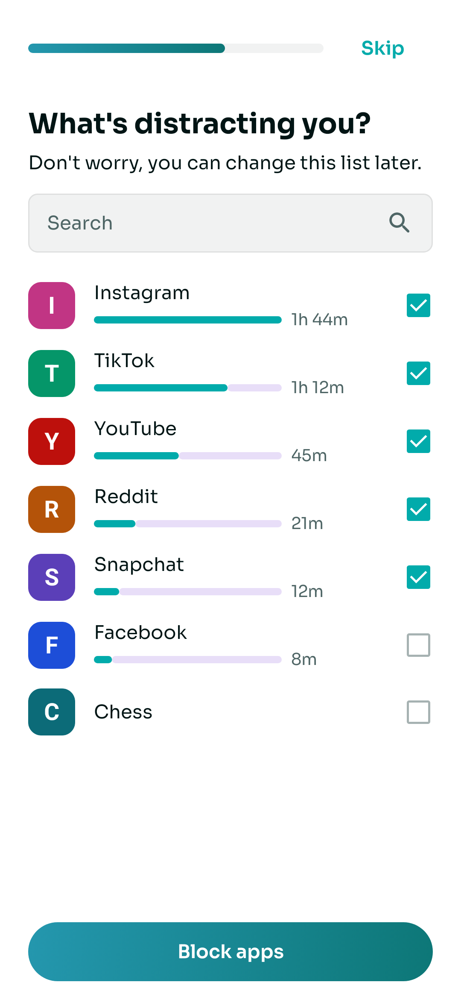
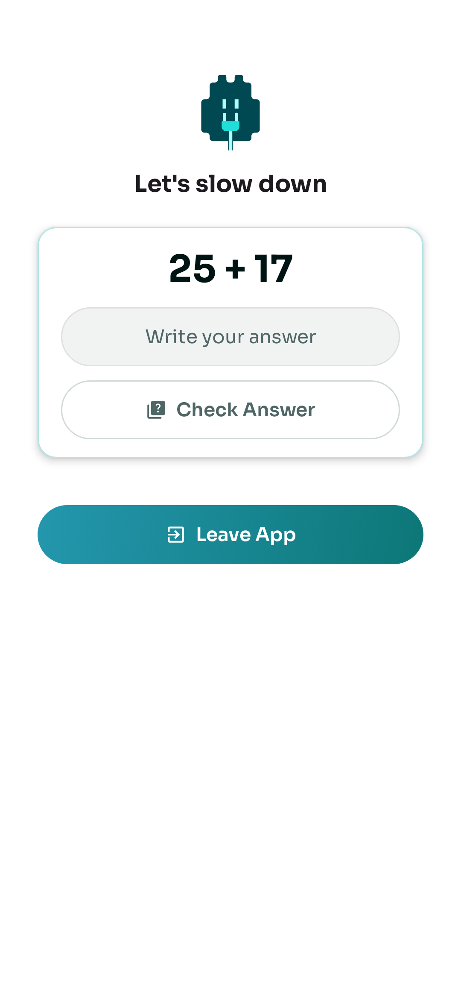
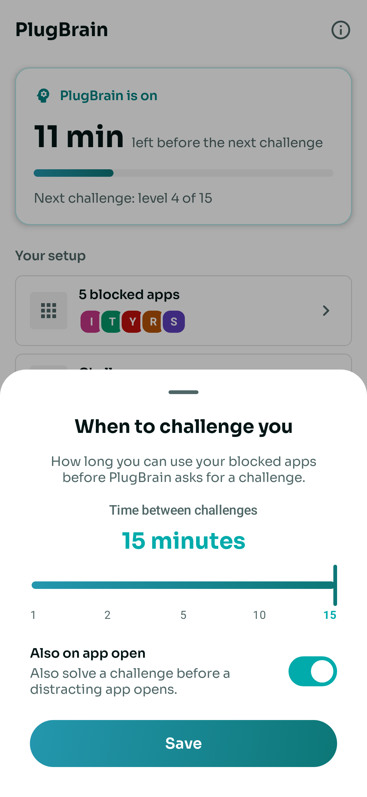
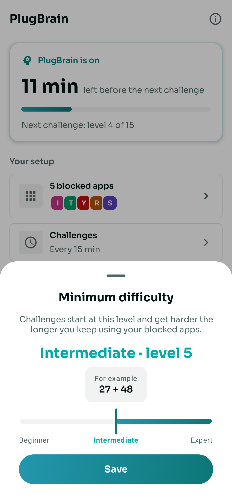

<div align="center">

<!-- Banner: to try another cover, replace assets/readme/banner.png (1920×1080, same as the store feature graphic). Nothing else needs to change. -->


# Plug your brain back in.

**PlugBrain is a free, open source Android app that puts a quick math problem between you and your distracting apps.**<br>
No ads, no tracking, no internet needed.

[](https://plugbrain.app)
[](https://f-droid.org/packages/app.plugbrain.android/)
[](https://apt.izzysoft.de/fdroid/index/apk/app.plugbrain.android)
[](https://github.com/msbelaid/PlugBrain/releases/latest)
[](https://github.com/msbelaid/PlugBrain/releases)
[](https://github.com/msbelaid/PlugBrain/actions/workflows/release-build.yml)
[](https://github.com/msbelaid/PlugBrain/commits/master)
[](https://github.com/msbelaid/PlugBrain/graphs/contributors)
[](https://codecov.io/gh/msbelaid/PlugBrain)
[](https://www.codefactor.io/repository/github/msbelaid/plugbrain)
[](LICENSE)
[](#download)
[](#contributing)
[](https://www.reddit.com/r/PlugBrain/)
[](https://contribute.design/msbelaid/PlugBrain)
[](https://github.com/msbelaid/PlugBrain/stargazers)

[Website](https://plugbrain.app) · [Download](#download) · [How it works](#how-it-works) · [Privacy](#privacy) · [Contributing](#contributing) · [Community](#community)

</div>

---

<div align="center">
  
  
  
  
</div>

## Why PlugBrain?

Most app blockers give you a timer you can tap past without thinking. PlugBrain makes you think.

- 🧮 **Friction you have to think through.** When it's time for a break, a math challenge stands between you and the app. Solve it to keep going, or take the hint and leave.
- 📈 **Adaptive difficulty.** Keep coming back and the problems get harder. Stay away and they ease off. Your own habits set the level.
- 🔒 **Private by design.** No internet permission, no account, no analytics, no ads. Nothing leaves your phone.
- 💚 **Free and open source.** GPL-3.0, on F-Droid with no anti-features, built in the open with the community.

## How it works

1. **Grant a few permissions.** PlugBrain needs them to see when a blocked app opens and show the challenge on top. The app explains each one, and [Privacy](#privacy) lists why.
1. **Pick the apps that distract you.** The list is sorted by how much you used each app in the last 24 hours.
1. **Choose how often to be challenged:** how many minutes of use before the next challenge.
1. **Choose your starting difficulty:** Beginner, Intermediate or Expert.
1. **Use your phone as usual.** When the time is up, PlugBrain shows a challenge over the blocked app. Answer it to carry on, or tap **Leave App**.

You can also ask PlugBrain to challenge you **as soon as a distracting app opens**, not only after a while.

Each challenge you solve makes the next one a level harder. Stay away and PlugBrain drops a level for every two challenge intervals you skip, down to the minimum you chose. More than 40 challenge types cover the range: from simple additions to five-digit sums, subtraction, multiplication tables up to 4×4 digits, squares, and missing-number equations like `? × 7 = 56`.

<div align="center">
  
  
  
  
</div>

## Download

PlugBrain runs on Android 9 and newer. Learn more on the website: **[plugbrain.app](https://plugbrain.app)**.

<p align="center">
  <a href="https://f-droid.org/packages/app.plugbrain.android/"></a>
  <a href="https://apt.izzysoft.de/fdroid/index/apk/app.plugbrain.android"></a>
  <a href="https://play.google.com/store/apps/details?id=app.plugbrain.android"></a>
  <a href="https://github.com/msbelaid/PlugBrain/releases/latest/download/app-release.apk"></a>
</p>

<details>
<summary>Other mirrors</summary>

- [OpenAPK](https://www.openapk.net/plugbrain/app.plugbrain.android/)
- [AndroidFreeware](https://www.androidfreeware.net/fr/download-plugbrain-apk.html)

</details>

Available in English, Arabic, Chinese (Simplified), Dutch, French, German, Hindi, Japanese, Persian and Russian. [Help add yours.](CONTRIBUTING.md#translation)

## Privacy

PlugBrain has **no internet permission**, so it can't send anything anywhere. There are no accounts, ads or trackers, and Google Play's data safety section lists no data collected or shared.

To block apps, it needs a few Android permissions. Each one is explained in the app before you grant it.

| Permission | Why |
|---|---|
| Usage access | Measures time spent in the apps you chose to block |
| Display over other apps | Shows the challenge on top of a blocked app |
| Accessibility service | Detects when a blocked app opens. It never reads content or captures input |
| Ignore battery optimizations | Keeps the blocker running in the background |

Read the full [privacy policy](PRIVACY_POLICY.md).

## Contributing

PlugBrain collects no analytics, so your feedback and contributions are how it gets better. You can:

- **Report a bug or suggest a feature** in [Issues](https://github.com/msbelaid/PlugBrain/issues).
- **Translate** the app and store listing ([guide](CONTRIBUTING.md#translation)).
- **Add a new challenge** in a few lines: `./gradlew generateChallenge -PchallengeName=MyChallenge` scaffolds it for you ([guide](CONTRIBUTING.md#creating-a-new-challenge-type)).
- **Design** screens, store graphics or a video walkthrough ([design guide](.design/README.md), [Figma file](https://www.figma.com/design/uYAs8XFheRGrCAcSqTQ5Sb/PlugBrain---Github)).
- **Pick up** a [good first issue](https://github.com/msbelaid/PlugBrain/issues?q=is%3Aissue+is%3Aopen+label%3A%22good+first+issue%22) or one marked [help wanted](https://github.com/msbelaid/PlugBrain/issues?q=is%3Aissue+is%3Aopen+label%3A%22help+wanted%22).

Start with [CONTRIBUTING.md](CONTRIBUTING.md). For code, fork the repo, work on a branch, and open a pull request. Before you push, make sure these pass:

```bash
./gradlew ktlintCheck
./gradlew detekt
./gradlew test
```

<details>
<summary><b>Tech stack</b></summary>

- 100% [Kotlin](https://kotlinlang.org/), [Jetpack Compose](https://developer.android.com/jetpack/compose) and [Material 3](https://m3.material.io/)
- MVVM with the repository pattern, [Koin](https://insert-koin.io/) for dependency injection
- [Coroutines & Flow](https://kotlinlang.org/docs/coroutines-overview.html), [Lifecycle](https://developer.android.com/jetpack/androidx/releases/lifecycle), [DataStore](https://developer.android.com/topic/libraries/architecture/datastore)
- [UsageStatsManager](https://developer.android.com/reference/android/app/usage/package-summary) for app usage, [Coil](https://coil-kt.github.io/coil/) for images, [Timber](https://github.com/JakeWharton/timber) for logging
- Tests with [JUnit](https://junit.org/junit5/), [MockK](https://mockk.io/) and [Paparazzi](https://github.com/cashapp/paparazzi) screenshot tests
- [ktlint](https://pinterest.github.io/ktlint/), [detekt](https://detekt.dev/) with [Compose rules](https://mrmans0n.github.io/compose-rules/) and [GitHub Actions](https://github.com/features/actions) for CI/CD

| Module | What's inside |
|---|---|
| `app` | Screens, blocking service and app wiring |
| `appusage` | App usage stats and installed apps |
| `challenges` | All math challenge types and their difficulty levels |
| `datastore` | User preferences |
| `designsystem` | Shared Compose components, colors and typography |

</details>

## Community

Share how you use PlugBrain, what works and what doesn't:

- [plugbrain.app](https://plugbrain.app), the official website
- [r/PlugBrain](https://www.reddit.com/r/PlugBrain/) on Reddit
- [GitHub Discussions](https://github.com/msbelaid/PlugBrain/discussions)

If PlugBrain helps you, a ⭐ on GitHub or a rating on [Google Play](https://play.google.com/store/apps/details?id=app.plugbrain.android) helps other people find it.

## Credits

Built by [@msbelaid](https://github.com/msbelaid) and [contributors](https://github.com/msbelaid/PlugBrain/graphs/contributors) from around the world. 🇩🇿 Made in Algeria.

UI design by [@HichemDahaoui](https://github.com/HichemDahaoui). Logo by [@travis-jeans](https://github.com/travis-jeans) ([style guide](.design/Logo.md)).

## License

PlugBrain is free software, released under the [GNU General Public License v3.0](LICENSE).
